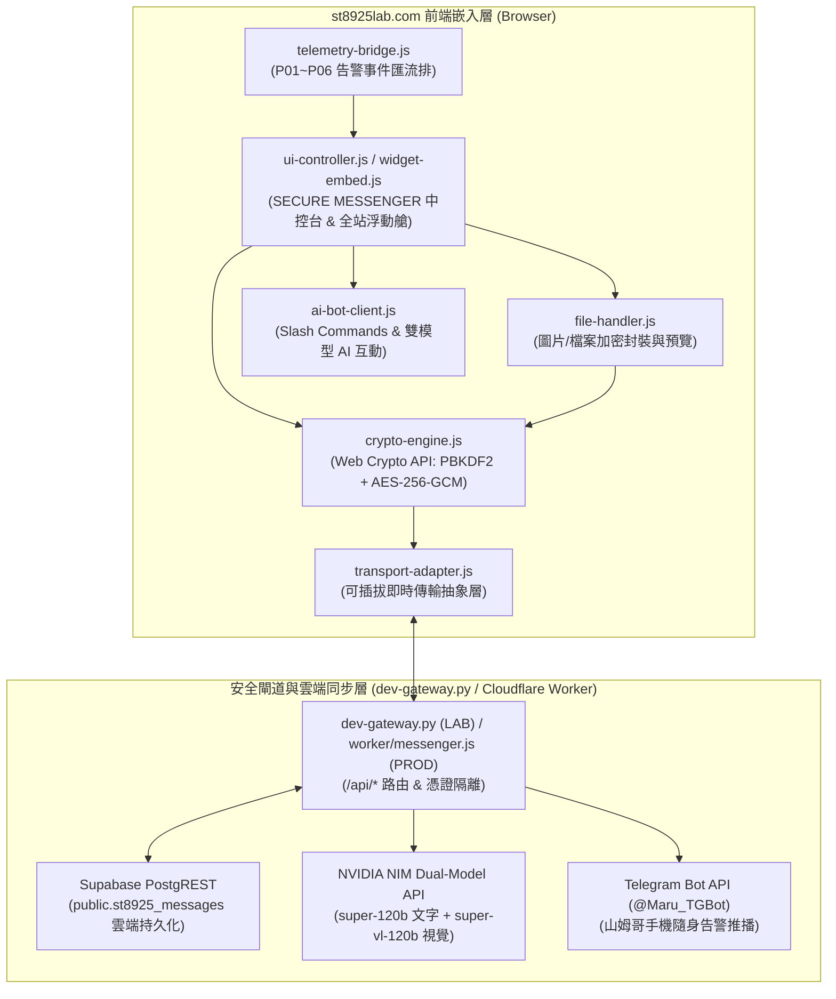

# ST8925 LAB — 嵌入式安全即時通訊系統 (SECURE MESSENGER & CHATOPS)


> 詳細產品規格與重建唯一依據請參閱 [`PROMPT.md`](./PROMPT.md)（見「一、 專案背景、本頁身份與前置依賴」至「五、 四大強制攔截點 (Hooks) 與量化門檻」）。歷史規格演進請參閱 [`CHANGELOG.md`](./CHANGELOG.md)。整站共用的架構決策（軌道、星雲爆炸、色相傳遞機制、共用站名元件等）記錄在網站根目錄的 `README.md` 與 `PROMPT.md`。


## 專案簡介
**SECURE MESSENGER & CHATOPS (ST-SecureMessenger)** 是專為 `https://st8925lab.com/` 打造的輕量、高資安、深色毛玻璃風格（`#04070e` 背景與 WCAG AAA 彩虹色系）嵌入式即時通訊與戰情協作系統。採用「進化版選項 2」架構，結合瀏覽器原生 **W3C Web Crypto API (`AES-256-GCM` / `PBKDF2`)** 端對端加密、**NVIDIA NIM 雙模型 AI 智慧路由**、**Supabase PostgREST 雲端持久化** 與 **Telegram (`@Maru_TGBot`) 隨身告警推播橋接**。


## 本頁身份 / Identity

| 項目 Item | 值 Value |
|---|---|
| 內部代碼 Internal id | `04`（永不變動 / never changes） |
| 顯示名稱 Display label | 取自 `config.js` 的 `PROJECTS[].label`（目前為 `SECURE MESSENGER & CHATOPS`） |
| 資料夾／URL Slug | `secure-messenger-chatops`（**必須**與 label 同步改名，見下方「命名同步規則」） |
| 軌道顏色 Ring colour | 由首頁彩虹配色第 4 環決定，隨機洗牌，透過 `?hue=` 傳遞至 `--c` |


## 命名同步規則 / Folder-Rename-on-Label-Change Rule

> ⚠️ 若修改了本專案在網站上顯示的名稱（`config.js` 的 `label` 欄位），**必須同步將本資料夾改名**，讓資料夾名稱與顯示名稱維持一致。不要只改 `label` 而漏改資料夾。
>
> 請於生產環境根目錄使用 `tools/rename_project.py` 一次原子性完成兩者：
> ```bash
> python tools/rename_project.py 04 "新的顯示名稱"
> python verify.py
> ```


## 核心功能與三大場景
1. **🌐 場景 A：訪客與 AI 接待室 (Guest & AI Concierge)**
   * 支援全站右下角浮動通訊艙（Floating Widget）與獨立中控台，訪客免註冊即可與駐站 AI 顧問對話，並可一鍵呼叫山姆哥透過 Telegram 推播即時接手（離線時誠實顯示「目前離線，通知未送出」）。
2. **🔒 場景 B：授權團隊 E2EE 私密包廂 (E2EE Secret Vault)**
   * 瀏覽器本地端 `AES-256-GCM`（12-byte 隨機 IV）文字與圖片／檔案端對端加解密，伺服器僅轉發與儲存密文（Zero-Knowledge），支援通行密語（Passphrase）衍生金鑰與即時鎖頭驗證狀態。
3. **⚡ 場景 C：P01～P06 戰情告警與 ChatOps 頻道 (System Telemetry & ChatOps)**
   * 與 `st8925lab.com` 旗下之 `01 ALARM NOTIFICATION SIMULATOR`、`02 IOT GEN2 SIMULATOR & MONITOR`、`03 AI DIAGNOSTIC KB`、`06 TRAVEL ASSISTANCE` 連動，支援結構化告警卡片、圖檔傳送與 `/status`、`/diag`、`/ask`、`/notify`、`/sim` 斜線指令。


## 模組架構圖



## 環境安裝與 API Key 設定方式
1. **LAB 本地環境 (`d:\Google Antigravity Proejct_free modification\Messebger\`)**：
   複製環境變數範本檔為 `.env`（`.env` 已列入 `.gitignore`，切勿提交至版本控制或複製至 PROD）：
   ```powershell
   Copy-Item .env.example .env
   ```
2. **PROD 生產環境 (`z:\11_st8925lab\`)**：
   * 非機密模型名稱已定義於根目錄 `wrangler.jsonc` 之 `"vars"` 區塊（`NVIDIA_NIM_TEXT_MODEL`、`NVIDIA_NIM_VISION_MODEL`）。
   * 敏感金鑰一律設定於 Cloudflare Dashboard (`Workers & Pages` -> `st8925lab` -> `Settings` -> `Runtime variables and secrets`)：
     * `NVIDIA_NIM_API_KEY`（或共用 `NVIDIA_API_KEY`，`Secret`）：NVIDIA NIM API 金鑰
     * `NVIDIA_NIM_TEXT_MODEL`（`Text`）：預設 `nvidia/nemotron-3-super-120b-a12b`
     * `NVIDIA_NIM_VISION_MODEL`（`Text`）：預設 `nvidia/nemotron-3.5-super-vl-120b-a12b`
     * `TELEGRAM_BOT_TOKEN`（`Secret`）：Telegram Bot 憑證 (`@Maru_TGBot`)
     * `TELEGRAM_CHAT_ID`（`Secret`）：接收告警推播之 Telegram Chat ID
     * `SUPABASE_URL`（`Text`）與 `SUPABASE_ANON_KEY`（`Secret`）：Supabase 雲端持久化端點


## 執行與驗證指令
1. **LAB 端：執行 6 大自動化與雲端連線驗證套件**：
   ```powershell
   python tests/verify_messenger.py
   ```
2. **LAB 端：啟動本地安全通訊閘道器 (`dev-gateway.py`)**：
   ```powershell
   python src/server/dev-gateway.py
   ```
   * **全站首頁預覽（含右下角浮動安全通訊艙）**：`http://127.0.0.1:8765/index.html`
   * **PROJECT 04 獨立戰情中控台**：`http://127.0.0.1:8765/project-04/index.html?hue=indigo`
3. **PROD 端 (`z:\11_st8925lab\`)：執行全站幾何擴充性與公開暴露面雙重驗證**：
   ```powershell
   $env:PYTHONIOENCODING="utf-8"
   python z:/11_st8925lab/verify.py
   python z:/11_st8925lab/tools/check_public_surface.py
   ```


## 原始資料夾歷史紀錄 (Preserved Legacy History from PROD)

| 日期 Date | 變更 Change | 說明 Notes |
|---|---|---|
| 2026-10-17 | 正式上線 SECURE MESSENGER & CHATOPS (`V1.4`) | 由舊 `project-04/` 佔位頁經 `tools/rename_project.py` 改名為 `secure-messenger-chatops/`，部署三頻道安全通訊中控台（Channel A 訪客與 AI 接待、Channel B Web Crypto `AES-256-GCM` E2EE 私密包廂、Channel C P01~P06 ChatOps）、字級縮放（`A- / 100% / A+`）、手機版橫向頻道條與 XSS 防護，並於 `worker/index.js` + `worker/messenger.js` 串接 `/api/*` 雲端路由。詳見 [`PROMPT.md`](./PROMPT.md) 與 [`CHANGELOG.md`](./CHANGELOG.md)。 |
| 2026-08-09 | 建立本資料夾 Folder created | 全站架構由「單一動態 `project.html?id=`」改為「六個獨立實體資料夾」，本頁取代舊有 `project.html?id=04` 的角色。內容：導覽列（共用站名元件，含 5 秒呼吸與 hover 逐字透鏡）＋ halo ＋ `this is "SECURE MESSENGER & CHATOPS" home page. Welcome to "SECURE MESSENGER & CHATOPS"` 文字＋返回首頁連結。頁面 accent color 沿用點擊軌道時傳遞的 `?hue=` 參數，與首頁色彩系統保持一致。詳見根目錄 README.md 與 PROMPT.md。<br>Site-wide architecture changed from a single dynamic `project.html?id=` page to six real folders. This page supersedes the old `project.html?id=04`. |
